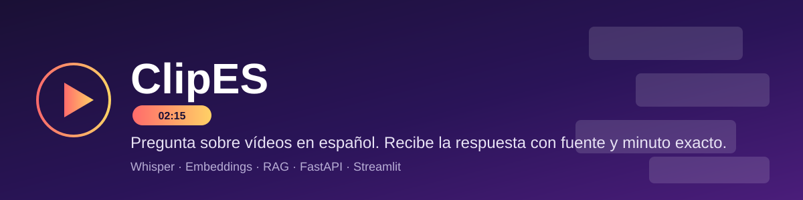

# ClipES

> 把西语 AI 科普视频变成一个能问答的知识库——提问即答,带时间戳出处,点开直接跳到视频对应时刻。

[Español](README.es.md) ｜ 中文（当前）

---

## 这是什么

[VideoListo](https://github.com/Lnnkun/VideoListo)（本地 Whisper 转录 + LLM 生成简介/章节/标签）和 [VideoBusca](https://github.com/Lnnkun/VideoBusca)（Embedding + 向量库 + RAG 问答,回答准确率 53%,如实记录)是两个独立的学习阶段项目。ClipES 把它们合并成一个产品:

- **后端**:一个 FastAPI 服务,统一暴露两条流水线——`/ask` 问答,`/ingest/transcribe` 收录新视频
- **前端**:一个 Streamlit 网页,输入问题拿到带出处的回答,出处可以点开直接跳到 YouTube 视频对应秒数

## 背后的产品判断

做这个整合之前,想清楚过"这东西到底解决谁的什么问题"——不是"西语视频创作者"(最初的设想,后来发现站不住脚),而是:

> 当我在做项目、卡在一个具体概念上时,想要快速拿到一个精准、有可信来源的答案,而不是在 YouTube 里漫无目的翻视频、拖进度条找那 30 秒。

ClipES 现在的形态(问一个具体问题 → 拿到带时间戳出处的回答)就是直接服务这个场景的,不多不少。

## 架构
```
clipes/                共用的 Python 包
  config.py             路径、模型名、集合名
  ingest.py             读取 data/transcripts/*.srt
  chunk.py              切成 30-60 秒的块
  index.py              向量化，存入 Chroma
  search.py             语义检索 top-10
  ask.py                RAG 问答（原 VideoBusca）
  transcribe.py         本地 Whisper 转录（原 VideoListo）
  meta.py               LLM 生成简介/章节/标签（原 VideoListo）

api.py                  FastAPI 后端，统一包装上面两条流水线
streamlit_app.py        前端网页，调用 api.py
```

## 环境准备
- Windows + Python 3.10，RTX 4060（8GB 显存）

```powershell
python -m venv .venv
.venv\Scripts\activate
python -m pip install --upgrade pip
# 先装 CUDA 版 PyTorch，再装其余依赖
pip install torch --index-url https://download.pytorch.org/whl/cu128
pip install -r requirements.txt
```

复制 `.env.example` 为 `.env`，填入：
```
OPENROUTER_API_KEY=你的 key
MODEL=deepseek/deepseek-v4.1-flash-1017
```

## 使用方法
```powershell
# 1. 建索引（已有 data/transcripts/*.srt，首次运行前必须做一次）
python -m clipes.chunk
python -m clipes.index

# 2. 启动后端（终端 A）
uvicorn api:app --reload

# 3. 启动前端（终端 B）
streamlit run streamlit_app.py
```

浏览器打开 Streamlit 给出的地址即可提问。后端接口文档在 http://127.0.0.1:8000/docs。

## 数据规模
沿用 VideoBusca 的语料：19 个西语 AI 科普视频，336 分钟音频，658 个检索块。完整的评估方法和真实分数（回答准确率 53%，拒答正确率 88%）见 [VideoBusca 仓库](https://github.com/Lnnkun/VideoBusca)。

## 和前两个项目的关系
- **VideoListo**：记录"转录 + 生成 YouTube 简介"这一步怎么做的，独立仓库保留
- **VideoBusca**：记录"检索 + RAG 问答 + 自动评估"这一步怎么做的，独立仓库保留
- **ClipES**：把两条流水线合并成一个能跑起来的完整产品，是这条学习路径目前的收尾
